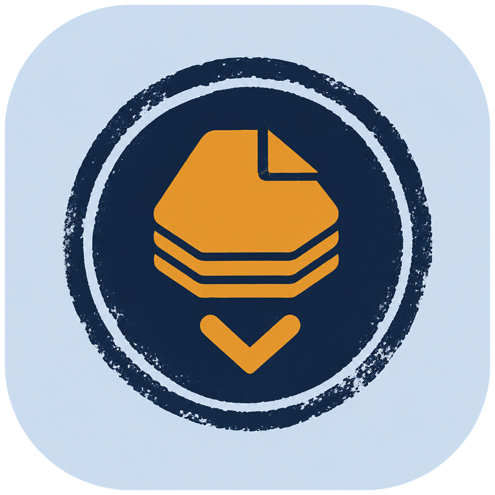
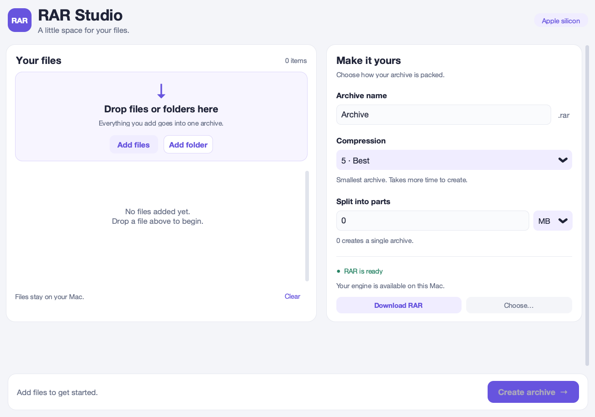

# RAR Studio



A small RAR archive maker for macOS on Apple silicon.



## Features

- Drag and drop files and folders, or add them with the file and folder buttons.
- Choose a compression level from Store to Best.
- Split archives into parts sized in KB or MB. Use `0` to make one archive.
- See creation progress while RAR builds the archive.
- Download the official RAR engine from inside the app; it is saved on your Mac for future use.

## Build on your Mac

Build on an Apple silicon Mac with Python 3 installed. From this project folder, run:

```bash
python3 -m pip install -r requirements.txt
python3 -m PyInstaller --noconfirm --clean --onefile --windowed --target-arch arm64 --name "RAR Studio" --icon app_icon.icns --collect-all customtkinter --collect-all tkinterdnd2 rar_mac.py
```

PyInstaller creates the app under `dist/`.

## Open the app without an Apple Developer ID

This personal build is unsigned and unnotarized. After building or downloading it, open Terminal in the project folder and run:

```bash
xattr -dr com.apple.quarantine "dist/RAR Studio.app"
```

Then open `dist/RAR Studio.app` from Finder. If you moved the app, use its new path in the command. This clears quarantine only from RAR Studio; it leaves Gatekeeper enabled for other apps. See [Apple's app security guidance](https://support.apple.com/en-gb/102445).

## RAR engine

RAR Studio downloads the macOS ARM command-line engine from [RARLAB](https://www.rarlab.com/download.htm) when you choose **Download RAR**. The app stores it in `~/Library/Application Support/RAR Studio/`. RAR is proprietary software; its trial and license terms apply.
